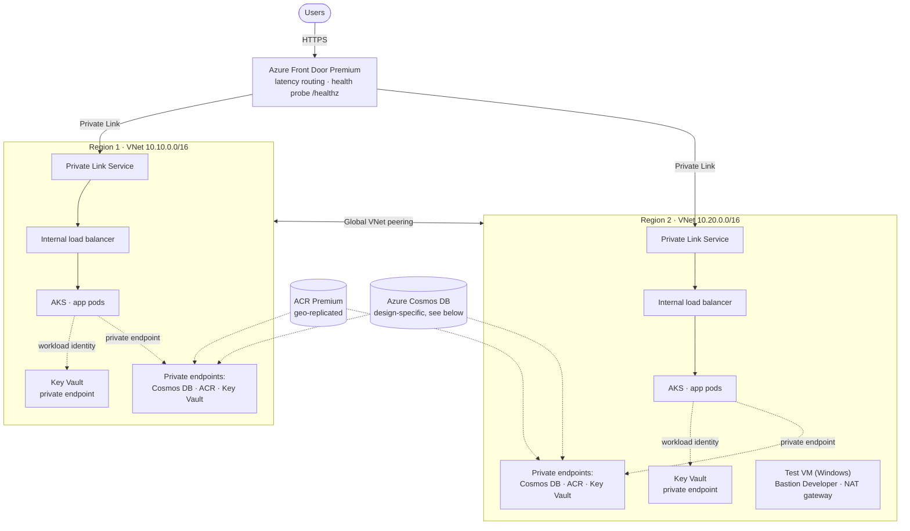
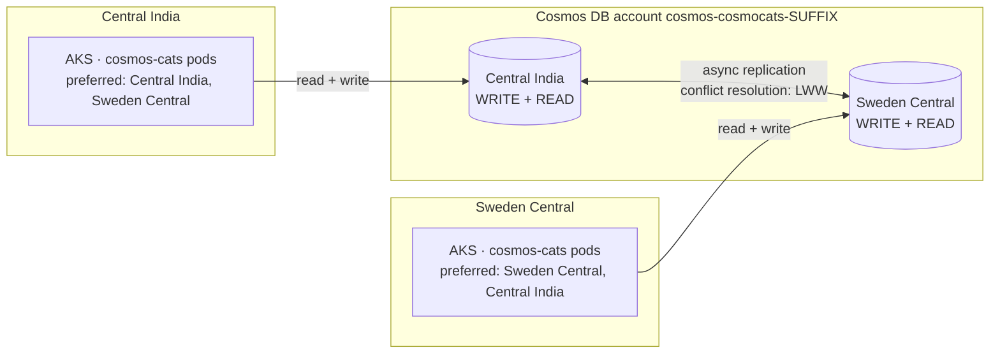
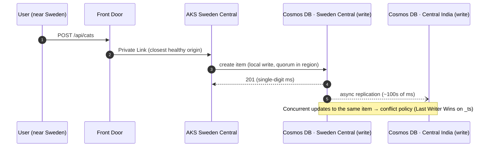
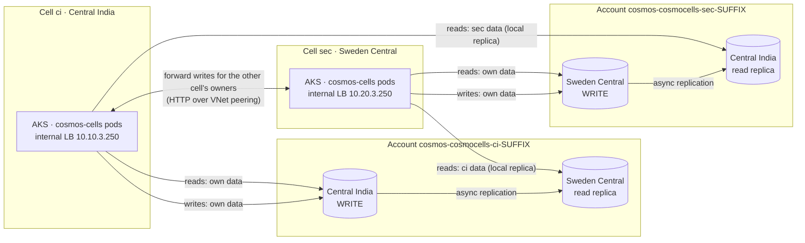
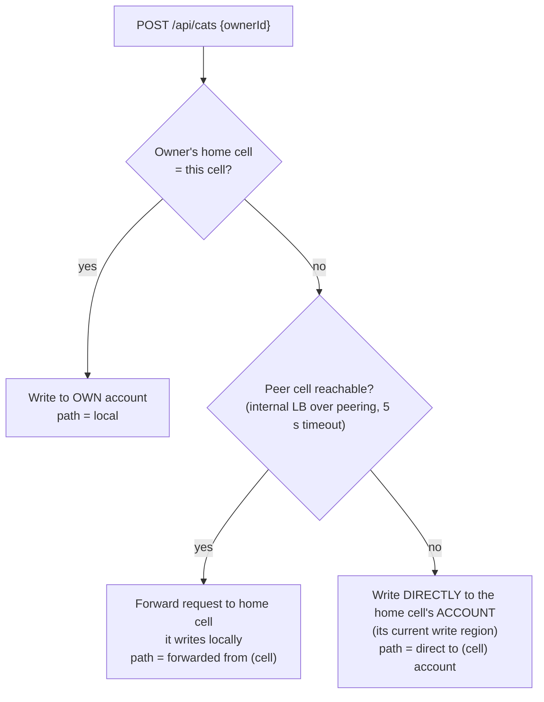
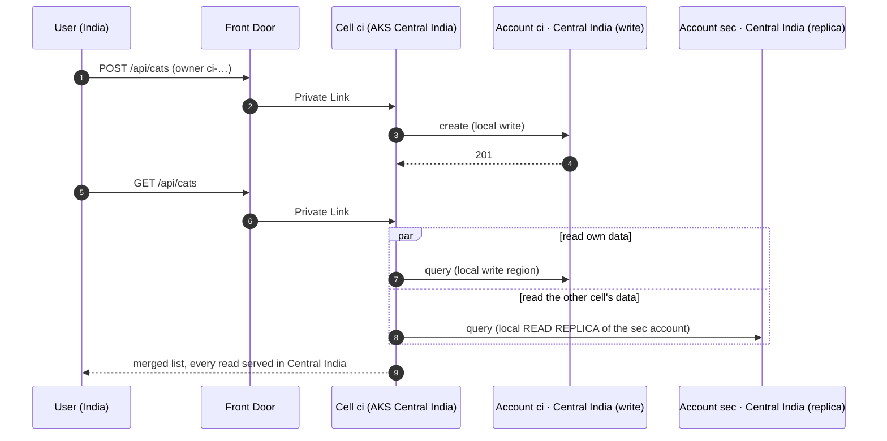
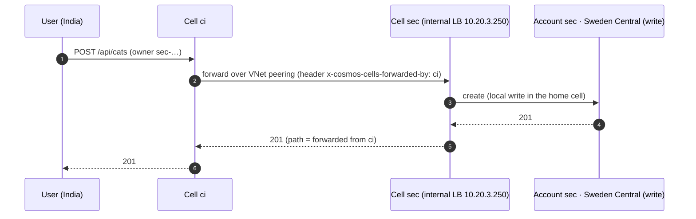
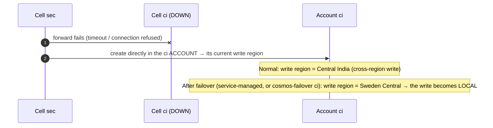
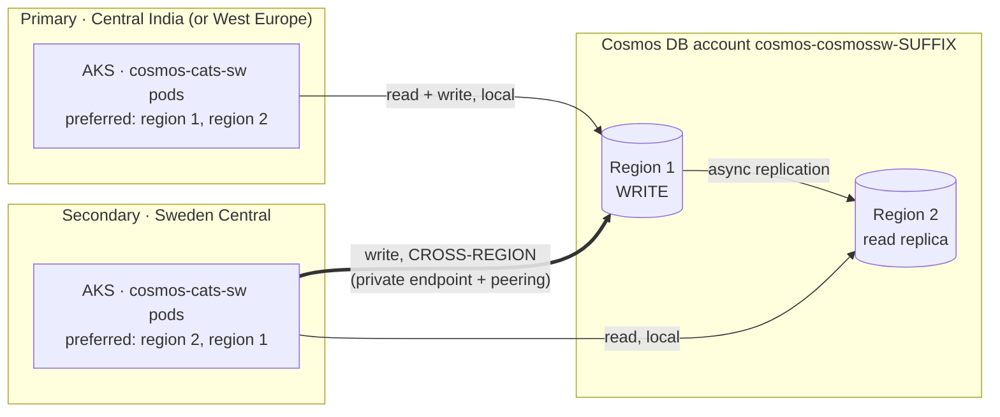
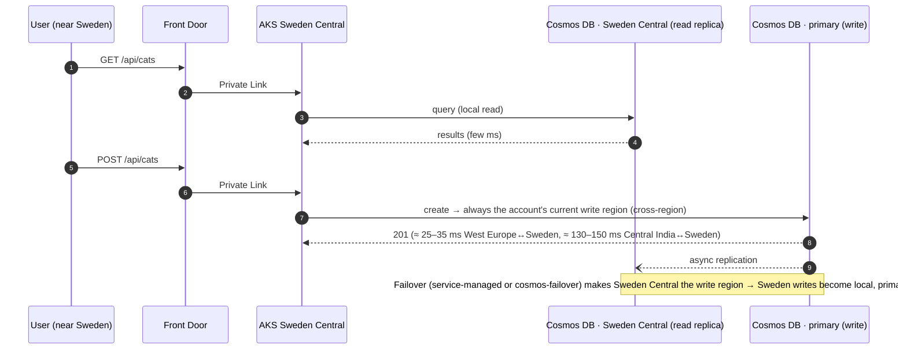

# Multi-Region Active-Active AKS + Azure Cosmos DB: Three Reference Designs

Three Azure CLI scripts that each deploy an **active-active, two-region AKS platform** behind **Azure Front Door Premium**, with **Azure Cosmos DB** as the data tier. They share the same secure foundation; they differ only in **how Cosmos DB handles writes across regions**:

| Script | Cosmos DB write model | One-line summary |
|---|---|---|
| [`aks-multiregion-cosmos-afd.sh`](#1-multi-region-write--aks-multiregion-cosmos-afdsh) | **Multi-region write**: one account, both regions writable | Every region writes locally; Cosmos DB replicates and resolves conflicts |
| [`aks-cells-cosmos-afd.sh`](#2-regional-cells--aks-cells-cosmos-afdsh) | **Regional cells**: one account per region, each with a single write region + a read replica in the other region | Each region owns its data and writes locally; the other region's data is read from a local replica |
| [`aks-singlewrite-cosmos-afd.sh`](#3-single-write-region--aks-singlewrite-cosmos-afdsh) | **Single write region**: one account, write in the primary region, read replica in the secondary | Reads are local everywhere; writes from the secondary cross to the primary |

Default regions: **Central India** (`REGION1`) and **Sweden Central** (`REGION2`). For the common customer scenario of **West Europe as primary, expanding to Sweden Central**, run any script with `REGION1=westeurope REGION2=swedencentral`.

Inspired by the Ignite 2019 demo [`Azure/aks-bestpractices-ignite19/multi_region_cosmos`](https://github.com/Azure/aks-bestpractices-ignite19/tree/master/multi_region_cosmos), rebuilt with private networking, Entra ID-only access and Front Door Premium.

---

## Contents

- [Which design should I use?](#which-design-should-i-use)
- [Shared foundation](#shared-foundation-all-three-scripts)
- [1. Multi-region write](#1-multi-region-write--aks-multiregion-cosmos-afdsh)
- [2. Regional cells](#2-regional-cells--aks-cells-cosmos-afdsh)
- [3. Single write region](#3-single-write-region--aks-singlewrite-cosmos-afdsh)
- [Prerequisites](#prerequisites)
- [Quick start](#quick-start)
- [Commands](#commands)
- [Configuration](#configuration-environment-variables)
- [Naming and resource groups](#naming-and-resource-groups)
- [Testing](#testing)
- [Troubleshooting](#troubleshooting)
- [Cost notes](#cost-notes)
- [Production considerations](#production-considerations)

---

## Which design should I use?

| | Multi-region write | Regional cells | Single write region |
|---|---|---|---|
| Cosmos DB accounts | 1 | 2 (one per region) | 1 |
| Write latency, region 1 | Local | Local | Local |
| Write latency, region 2 | Local | Local (own data); forwarded to the home cell for the other cell's data | **Cross-region** to region 1 |
| Read latency | Local | Local (own write region or the other account's replica) | Local |
| Write conflicts possible | **Yes**, resolved by the conflict policy (Last Writer Wins by default) | No (each record has one writer) | No |
| Strong consistency | Not available | Per account | Available |
| App changes | Set preferred regions | Data has a **home region**; route or forward writes to it | Set preferred regions |
| Write capacity grows in region 2 | Yes | **Yes**: new tenants or data live in region 2 | No: all writes stay in region 1 |
| Write availability SLA | 99.999 % | 99.99 % per account | 99.99 % |
| Complexity | Low | Medium–high | **Lowest** |

**Rules of thumb**

- **Regions close together** (e.g. West Europe ↔ Sweden Central, ~25–35 ms): **single write region** is simple and usually good enough.
- **Regions far apart** (e.g. Central India ↔ Sweden Central, ~130–150 ms), or you want to **move write load and growth out of a capacity-constrained region**: **regional cells**.
- **Every region must write locally to the same data**, and you can design for conflicts: **multi-region write**.

---

## Shared foundation (all three scripts)



| Area | Implementation |
|---|---|
| **Ingress** | Front Door Premium → Private Link → Private Link Service → **internal** load balancer → AKS. The app has **no public IP**. The scripts approve Front Door's Private Link connections automatically. |
| **Routing** | Both origins have equal priority and weight, so traffic is **active-active** and each user goes to the lowest-latency healthy region. Health probe: `/healthz`. |
| **Compute** | One AKS cluster per region: Azure CNI Overlay in a custom VNet, user-assigned control-plane identity, OIDC issuer, **workload identity**, Key Vault CSI driver with secret rotation. 2 app replicas spread across nodes. |
| **Data access** | **Entra ID only.** Cosmos DB local auth (keys) is **disabled**. Each region's workload identity gets the **Cosmos DB Built-in Data Contributor** role (data-plane RBAC). |
| **Secrets** | A Key Vault per region holds the Cosmos DB endpoint(s), written through Azure Resource Manager so no data-plane access is needed, and mounted into pods by the CSI driver |
| **Private networking** | Cosmos DB, ACR and Key Vault are reachable **only through private endpoints** in each VNet, with public access disabled. Each region has its own private DNS zones, and the scripts **check that the A records exist**. |
| **Connectivity** | Non-overlapping VNets (10.10/16, 10.20/16) with **global VNet peering** in both directions |
| **Registry** | ACR Premium, geo-replicated to region 2. The app image is built in ACR from source **embedded in the script**. Public access is opened only for the build, then disabled. |
| **Test VM** | Every deployment ends by creating a Windows Server 2025 VM in **Sweden Central** (no public IP, NAT gateway for outbound, **Azure Bastion Developer** for RDP). It then calls the Front Door URL from inside the region. |

### Address plan (same in every script)

| Subnet | Region 1 | Region 2 |
|---|---|---|
| `snet-aks` (nodes) | 10.10.0.0/22 | 10.20.0.0/22 |
| `snet-pe` (private endpoints) | 10.10.8.0/24 | 10.20.8.0/24 |
| `snet-pls` (Private Link Service) | 10.10.9.0/24 | 10.20.9.0/24 |
| `snet-vm` (test VM, Sweden Central) | 10.10.10.0/24 | 10.20.10.0/24 |
| `AzureBastionSubnet` (only with `BASTION_SKU=Basic/Standard`) | 10.10.11.0/26 | 10.20.11.0/26 |

---

## 1. Multi-region write · `aks-multiregion-cosmos-afd.sh`

**One Cosmos DB account with both regions writable** (`enableMultipleWriteLocations = true`). Each region's pods write to their local region; Cosmos DB replicates asynchronously and resolves conflicts.

### Architecture



### Data flow



### Behaviour

- **Writes:** local in both regions.
- **Reads:** local in both regions.
- **Consistency:** Session (Strong isn't available with multi-region writes).
- **Region outage:** the SDK sends traffic to the other region; **no failover is needed for writes**. Writes not yet replicated (typically under a second's worth) can be lost.
- **Data model:** `catsdb` / `cats` (partition key `/id`). The demo inserts only new IDs, so conflicts don't occur.
- **Second region capacity:** the account is created in region 1, then region 2 is added. If region 2 lacks Cosmos DB capacity, set `COSMOS_REGION2_CANDIDATES` to fall back to other regions.

### Demo app: `cosmos-cats`

| Element | Shows |
|---|---|
| Header colour | **Orange = Central India**, **blue = Sweden Central**, plus the pod name |
| *Added via AKS region* | The cluster that handled the request |
| *Written to Cosmos region* | The Cosmos DB region that accepted the write (from SDK diagnostics) |
| *Read from* (status line) | The Cosmos DB region that served the list |

---

## 2. Regional cells · `aks-cells-cosmos-afd.sh`

**No multi-region writes.** Each region is a **cell** that owns a Cosmos DB account with a **single write region in its own cell** and a **read replica in the other cell**. Data is **homed**: an owner (think user or tenant) belongs to the cell that created it, and all its records are written to that cell's account. Each record has exactly one writer, so **conflicts are impossible**.

### Architecture



Each VNet has **private endpoints to both accounts**, so the regional endpoints of both accounts (write region and replica) resolve to private IPs in that VNet. Each cell's workload identity has data-plane access to **both** accounts: it writes its own, reads the other, and writes the other directly if that cell is down.

### Data model

| Container | Partition key | Contents |
|---|---|---|
| `owners` | `/id` | Owner `{ id: "<cell>-<random>", name, homeCell, homeRegion }`. The **cell code prefix in the ID** identifies the home cell, so no directory lookup is needed. |
| `cats` | `/ownerId` | Cat `{ ownerId, name, homeCell, receivedBy, writtenByCell, path, … }` |

Both containers exist in both accounts (database `catsdb`, 400 RU/s shared).

### Write path decision



### Data flows

**a) Local write and local reads**



**b) Write for an owner homed in the other cell (forwarding)**



**c) Home cell down: direct write; d) region down: account failover**



### Behaviour

- **Writes:** always local to the owner's home cell.
- **Reads:** local in both cells; the other cell's data may be slightly stale (asynchronous replica).
- **Consistency:** `COSMOS_CONSISTENCY` per account (default Session; **Strong is possible**, since each account has one write region).
- **Cell outage:** Front Door removes the unhealthy origin. The surviving cell reads everything from local replicas and writes the failed cell's data directly to its account.
- **Region outage:** **service-managed failover** promotes the replica of the affected account. The surviving cell then writes **both** accounts locally. Writes not yet replicated (seconds) can be lost.
- **Failover drill:** `./aks-cells-cosmos-afd.sh cosmos-failover ci` moves account ci's write region to Sweden Central; run it again to move it back.

### Demo app: `cosmos-cells`

1. **Create an owner.** It's homed in the cell serving the page; the ID is prefixed with the cell code.
2. **Add a cat** for any owner.

| Column | Meaning |
|---|---|
| *Home cell* | The cell that owns the record |
| *Received by* | The cell Front Door sent the request to |
| *Write path* | `local` · `forwarded from <cell>` · `direct to <cell> account (peer cell unreachable)` |
| *Read from (account → region)* | Which account the row came from and which region served the read. E.g. `sec → centralindia` means Sweden-owned data read from the **local replica in Central India**. |

---

## 3. Single write region · `aks-singlewrite-cosmos-afd.sh`

**One Cosmos DB account, one write region** (region 1, the primary) and a **read replica** in region 2. The app tier is active-active; the data tier has one writer. This is the simplest model and needs no app changes beyond preferred regions.

### Architecture



### Data flow



### Behaviour

- **Writes:** local in the primary region, **cross-region** from the secondary. The app records the latency of each write.
- **Reads:** local in both regions.
- **Consistency:** any level, including **Strong**, via `COSMOS_CONSISTENCY`.
- **Primary region outage:** service-managed failover promotes the secondary. The SDK discovers the new write region automatically.
- **Failover drill:** `./aks-singlewrite-cosmos-afd.sh cosmos-failover`; run it again to fail back.
- **Data model:** `catsdb` / `cats` (partition key `/id`).

### Demo app: `cosmos-cats-sw`

| Element | Shows |
|---|---|
| Header | The serving region, plus the account's **live write region and read replicas** (they change after a failover) |
| *Written to Cosmos region* | Always the current write region |
| *Write latency* | The cost of the write: local in the primary, cross-region from the secondary |
| Status line | The region that served the read and the read time (always local) |

---

## Prerequisites

- **Ubuntu or WSL (Ubuntu).** The scripts install anything missing: `curl`, `jq`, Azure CLI, `kubectl`, `kubelogin`.
- An Azure subscription where you are **Owner**, or **Contributor + User Access Administrator**. The scripts create role assignments.
- Resource providers are registered automatically.
- Quota for 2 × 2-vCPU nodes per region, plus 1 test VM.

> **Policy-friendly:** built for subscriptions that enforce *public network access disabled* on PaaS, *Cosmos DB local auth disabled*, restricted VM sizes per region, and no availability zones in some regions.

---

## Quick start

```bash
git clone <this repo> && cd <repo>
chmod +x aks-*-cosmos-afd.sh

./aks-multiregion-cosmos-afd.sh      # design 1: multi-region write
./aks-cells-cosmos-afd.sh            # design 2: regional cells
./aks-singlewrite-cosmos-afd.sh      # design 3: single write region

# customer scenario
REGION1=westeurope REGION2=swedencentral ./aks-singlewrite-cosmos-afd.sh
```

Each deployment takes **~50–70 min** and ends with a summary: the **Front Door URL**, resource names, and the test VM's results. Allow **15–20 min** for Front Door to start serving.

- The three scripts use **different prefixes and resource groups**, so they can be deployed side by side (each has its own Front Door Premium profile, which affects cost).
- The scripts are **re-runnable**: they skip what already exists, so after a failure fix the cause and run again.

> ⚠️ Don't replace or edit a script **while it is running**. Bash reads scripts incrementally, and a mid-run swap causes random syntax errors. Run from a local copy (e.g. your WSL home), not a synced folder.

---

## Commands

| Command | multi-region | cells | single-write |
|---|:-:|:-:|:-:|
| `./<script>`: deploy or continue | ✔ | ✔ | ✔ |
| `./<script> status`: write/read regions of the account(s) | | ✔ | ✔ |
| `./<script> cosmos-failover`: manual write-region failover (run again to fail back) | | `cosmos-failover <ci\|sec>` | ✔ |
| `./<script> testvm`: (re)create the Sweden Central test VM and test through Front Door | ✔ | ✔ | ✔ |
| `./<script> testvm-run`: re-run the Front Door test from the VM | ✔ | ✔ | ✔ |
| `./<script> destroy`: delete all `rg-<prefix>-*` groups **in the background** (default) | ✔ | ✔ | ✔ |
| `./<script> destroy --wait`: delete, wait (~15–20 min) and purge soft-deleted Key Vaults | ✔ | ✔ | ✔ |

---

## Configuration (environment variables)

| Variable | Default | Scripts | Purpose |
|---|---|---|---|
| `REGION1` / `REGION2` | `centralindia` / `swedencentral` | all | The two regions (region 1 is the primary in single-write) |
| `PREFIX` | `cosmocats` / `cosmocells` / `cosmossw` | all | Name prefix (keeps the three designs apart) |
| `NODE_COUNT` | `2` | all | Nodes per cluster |
| `NODE_VM_SIZE1` / `NODE_VM_SIZE2` | `Standard_B2s_v2` | all | Node size per region. If the subscription rejects it, an allowed 2-vCPU size is picked from the error. |
| `API_AUTHORIZED_IPS` | — | all | Restrict the AKS API servers, e.g. `203.0.113.10/32` |
| `IMAGE_TAG` / `FORCE_BUILD` | per script / `false` | all | App image tag / force a rebuild |
| `SKIP_TEST_VM` | `false` | all | Don't create the test VM |
| `TEST_VM_REGION` | `swedencentral` | all | Region (one of the two) for the test VM |
| `TEST_VM_SIZE` | that region's AKS node size | all | Test VM size |
| `BASTION_SKU` | `Developer` | all | `Developer` (free, no subnet or public IP, 1 session) or `Basic` / `Standard` (dedicated host) |
| `COSMOS_CONSISTENCY` | `Session` | cells, single-write | `Session` · `BoundedStaleness` · `Strong` · `ConsistentPrefix` · `Eventual` |
| `COSMOS_REGION2` | `$REGION2` | multi-region | Second Cosmos DB write region |
| `COSMOS_REGION2_CANDIDATES` | `$COSMOS_REGION2` | multi-region | Fallback regions if one has no Cosmos DB capacity |
| `CELL1` / `CELL2` | derived (`ci`, `sec`, `weu`, …) | cells | Cell codes used in names and owner IDs |

---

## Naming and resource groups

Each deployment gets a random 5-character **suffix**, saved in `~/.<prefix>-multiregion.env`, that is used in **every resource and resource group name**:

| Resource group | Contents |
|---|---|
| `rg-<prefix>-global-<suffix>` | Cosmos DB account(s), ACR Premium + replica, Front Door Premium |
| `rg-<prefix>-<r1>-<suffix>` | Region 1: VNet, private DNS zones, private endpoints, Key Vault, AKS, identities |
| `rg-<prefix>-<r2>-<suffix>` | Region 2: the same, plus the test VM, NAT gateway and Bastion (Sweden Central) |
| `MC_*` (managed by AKS) | Node pools, internal load balancer, Private Link Service |

| Resource | Multi-region write | Cells | Single write |
|---|---|---|---|
| Cosmos DB | `cosmos-cosmocats-<suffix>` | `cosmos-cosmocells-ci-<suffix>`, `cosmos-cosmocells-sec-<suffix>` | `cosmos-cosmossw-<suffix>` |
| AKS | `aks-cosmocats-ci` / `-sec` | `aks-cosmocells-ci` / `-sec` | `aks-cosmossw-ci` / `-sec` |
| Namespace / app | `cosmocats` / `cosmos-cats` | `cosmocells` / `cosmos-cells` | `cosmossw` / `cosmos-cats-sw` |

> Deployments created before resource group names carried the suffix keep their old names (`rg-<prefix>-global`, …). The scripts detect this automatically until the deployment is destroyed and redeployed.

---

## Testing

### Through Front Door from Sweden Central (automatic)

Every deployment ends with the test VM `vm-afdtest-sec` calling `https://<afd>/api/info` six times:

```
call 1: served by AKS region = Sweden Central  pod = …
```

Browse yourself: Azure portal → `vm-afdtest-sec` → **Connect → Bastion**. Credentials are in `~/.<prefix>-testvm.txt`.

### Each region directly (without Front Door)

```bash
kubectl --context aks-<prefix>-ci  -n <namespace> port-forward svc/<app> 8080:80
kubectl --context aks-<prefix>-sec -n <namespace> port-forward svc/<app> 8081:80
```

### App failover (all designs)

```bash
kubectl --context aks-<prefix>-sec -n <namespace> scale deploy/<app> --replicas 0
./<script> testvm-run      # now served by Central India (allow 1–2 min)
kubectl --context aks-<prefix>-sec -n <namespace> scale deploy/<app> --replicas 2
```

### Design-specific tests

| Design | Test | Expected |
|---|---|---|
| Multi-region write | Add cats from both regions | *Written to Cosmos region* = the local region in each case; every cat appears in both regions within seconds |
| Cells | Create an owner in each cell; add cats for both owners from both cells | `local` for own owners; `forwarded from <cell>` for the other cell's owners; *Read from* always shows the local region |
| Cells | Scale cell ci to 0, then add a cat for a ci owner from sec | `direct to ci account`, written to Central India |
| Cells | `cosmos-failover ci`, then repeat the previous test | The direct write now lands in **Sweden Central** |
| Single write | Add cats from both regions | *Write latency* is low from the primary and higher (cross-region) from Sweden Central |
| Single write | `cosmos-failover`, then add cats again | The header shows the new write region; the latencies swap |

---

## Troubleshooting

| Symptom | Cause / fix |
|---|---|
| `VM size … is not allowed in your subscription` | Size restrictions per region. The scripts fall back automatically, or set `NODE_VM_SIZE1` / `NODE_VM_SIZE2`. |
| `AvailabilityZoneNotSupported` | The scripts don't use availability zones |
| Cosmos DB `high demand in <region>` | No regional capacity. Request access at https://aka.ms/cosmosdbquota (multi-region: `COSMOS_REGION2_CANDIDATES`). |
| Pods `ContainerCreating`, `FailedMount … no such host` | A private DNS A record is missing. The scripts create or validate the records for every private endpoint; re-run. |
| Pods `0/1`, log `Local Authorization is disabled` | An old image that used keys. Current images use Entra ID; re-run with `FORCE_BUILD=true`. |
| `lookup …azmk8s.io … no such host` (NXDOMAIN) | The cluster is **stopped** (e.g. an auto-shutdown). The scripts start stopped clusters, or run `az aks start`. |
| `unrecognized arguments: --enable-private-link` | Front Door CLI changes between versions. The scripts use the ARM REST API for origins and routes. |
| `make sure that the originGroup is created successfully…` | Origins were still provisioning. The scripts wait and retry; re-run. |
| `syntax error near unexpected token` mid-run | The script file was replaced while running. Wait for the run to finish before updating it. |
| Test VM calls return errors right after deployment | Front Door is still propagating; `./<script> testvm-run` in 10–15 min |
| Cells: *Written to region* column empty | Known display gap: the write region isn't stored on the record. Write path and home cell identify it. |

```bash
kubectl --context <aks> -n <namespace> get pods,svc
kubectl --context <aks> -n <namespace> get events --sort-by=.lastTimestamp | tail
kubectl --context <aks> -n <namespace> logs deploy/<app> --tail=30
az aks list --query "[].{name:name, power:powerState.code, state:provisioningState}" -o table
```

---

## Cost notes

Per deployment, the main drivers are:

- **Front Door Premium:** ~$330/month base, required for Private Link origins
- **ACR Premium** with a replica
- **Cosmos DB:**
  - Multi-region write: 400 RU/s in 2 write regions
  - Cells: 2 accounts × (400 RU/s × 2 regions)
  - Single write: 400 RU/s × 2 regions
- **4 AKS nodes**
- **The test VM and NAT gateway** (Bastion Developer is free)

Pause:

```bash
az aks stop -g rg-<prefix>-ci-<suffix>  -n aks-<prefix>-ci
az aks stop -g rg-<prefix>-sec-<suffix> -n aks-<prefix>-sec
az vm deallocate -g rg-<prefix>-sec-<suffix> -n vm-afdtest-sec
```

Remove: `./<script> destroy` (background), or `destroy --wait` to also purge the Key Vaults.

---

## Production considerations

These scripts build reference and demo environments. Before production, consider:

- **Hub-and-spoke or Virtual WAN** per region with Azure Firewall, centralized private DNS and egress control, instead of direct peering
- **Private AKS clusters** (or API server VNet integration) with CI/CD from inside the network
- **Availability zones** for AKS and Cosmos DB where the region and subscription allow
- **WAF policy**, custom domain with managed certificate, and **HTTPS to the origin** on Front Door
- An ingress controller (App Routing / NGINX), HPA, PodDisruptionBudgets and KEDA for workers
- **Cells:**
  - Home-region routing at Front Door (cookie or token claim)
  - **Service Bus** instead of synchronous HTTP forwarding (outbox pattern)
  - A tenant directory for relocation
  - Change feed into a global read model for reporting
- **Multi-region write:** an explicit conflict-resolution policy and idempotent writes
- **Single write:** measure write latency from the secondary, and choose consistency accordingly (Strong is viable for nearby regions)
- An image build pipeline inside the network, so ACR never needs public access
- **Infrastructure as code** (Bicep / Terraform) for long-lived environments
- Azure Monitor / Container Insights, Managed Prometheus / Grafana, Cosmos DB and Front Door diagnostics and alerts
